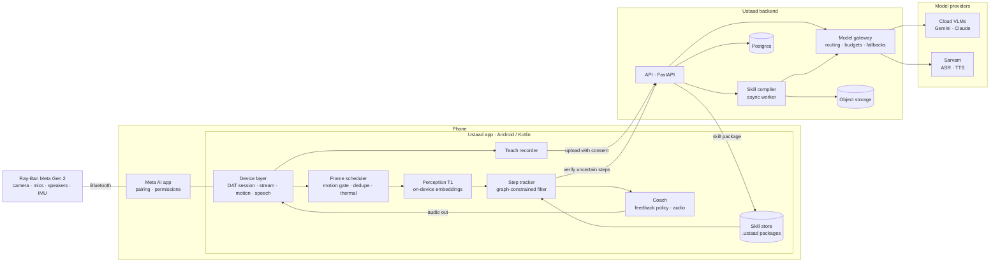
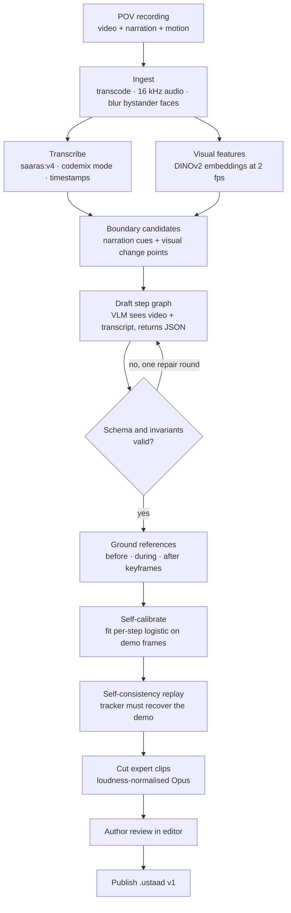
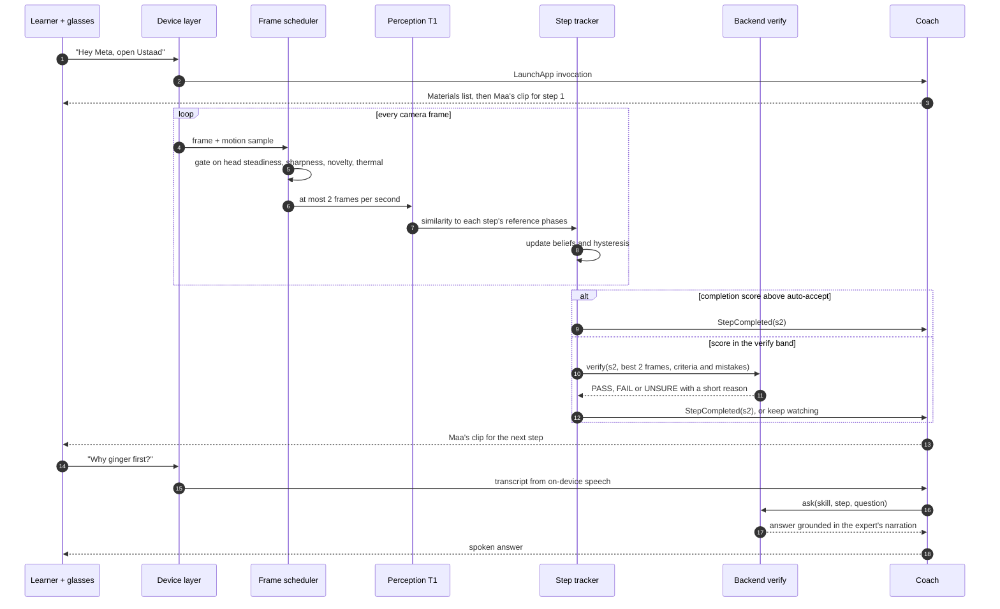
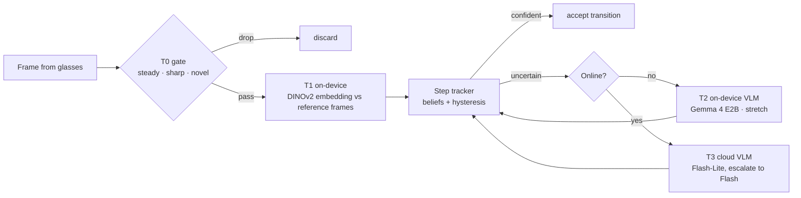
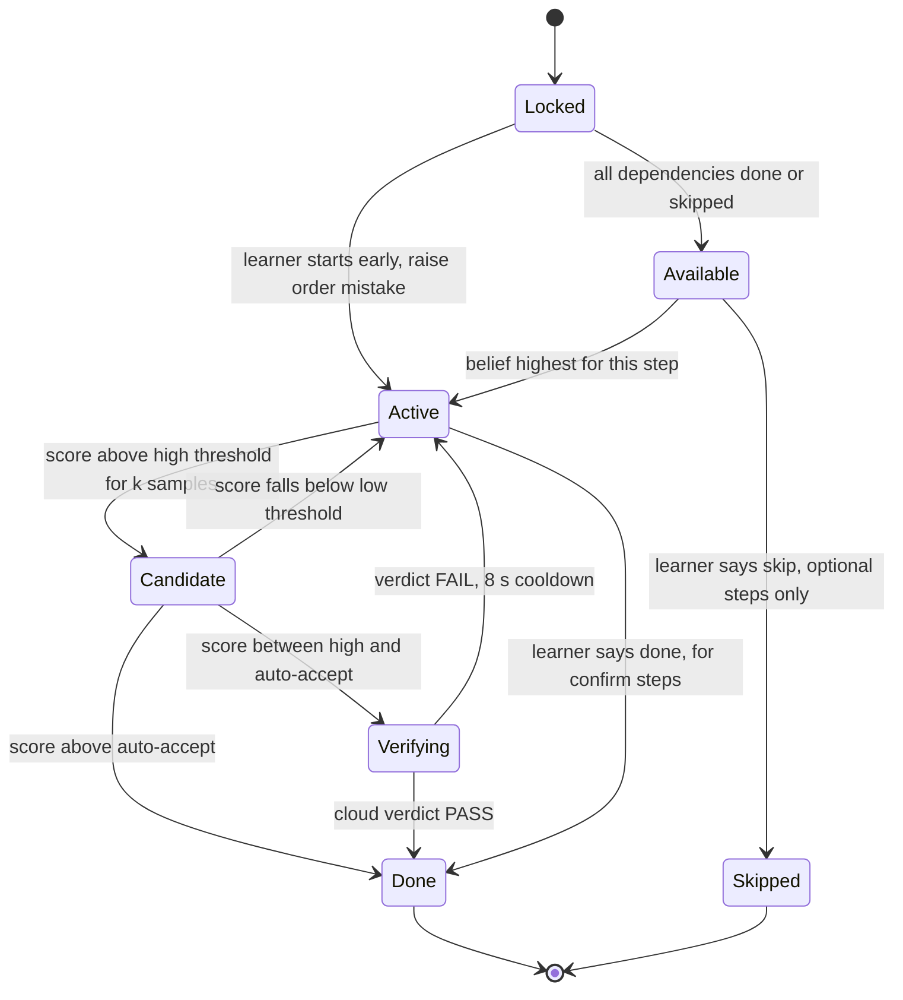
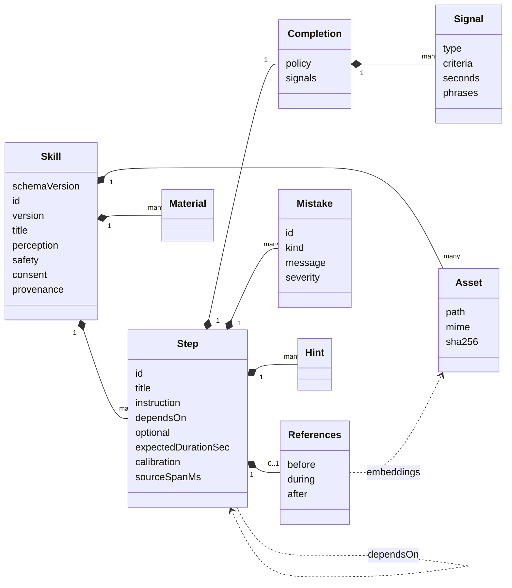

# Ustaad — Design Document

**Record a physical skill once on Ray-Ban Meta glasses. Coach anyone through it, live, in the expert's own voice.**

| | |
|---|---|
| **Status** | Draft v0.1, open for review |
| **Author** | [@Dragon-hearted](https://github.com/Dragon-hearted) |
| **Last updated** | 2026-10-21 |
| **Target hardware** | Ray-Ban Meta (Gen 2), no display |
| **SDK** | Meta Wearables Device Access Toolkit (DAT) 1.0.x, Android first |
| **Related files** | [`schemas/skill.schema.json`](../schemas/skill.schema.json), [`examples/masala-chai/skill.json`](../examples/masala-chai/skill.json), [`tools/validate_skill.py`](../tools/validate_skill.py) |

> Numbers marked **target** are goals to validate, not measurements. Model names are current as of October 2026 and live in config, so swapping one is a config change plus an eval run.

---

## Contents

- [0. Summary](#0-summary)
- [1. Context and problem](#1-context-and-problem)
- [2. Goals and non-goals](#2-goals-and-non-goals)
- [3. Users and scenarios](#3-users-and-scenarios)
- [4. Platform constraints](#4-platform-constraints)
- [5. Architecture](#5-architecture)
- [6. Component design](#6-component-design)
- [7. Skill file data model](#7-skill-file-data-model)
- [8. Models and APIs](#8-models-and-apis)
- [9. Latency and cost](#9-latency-and-cost)
- [10. Privacy, safety and compliance](#10-privacy-safety-and-compliance)
- [11. Evaluation](#11-evaluation)
- [12. Observability](#12-observability)
- [13. Failure modes](#13-failure-modes)
- [14. Testing strategy](#14-testing-strategy)
- [15. Alternatives considered](#15-alternatives-considered)
- [16. Milestones](#16-milestones)
- [17. Open questions and risks](#17-open-questions-and-risks)
- [Appendix A. Interface sketches](#appendix-a-interface-sketches)
- [Appendix B. Prompt sketches](#appendix-b-prompt-sketches)
- [Appendix C. Repository layout](#appendix-c-repository-layout)
- [Appendix D. Glossary](#appendix-d-glossary)
- [Appendix E. References](#appendix-e-references)

---

## 0. Summary

Ustaad has two modes.

- **Teach.** An expert wears the glasses and does a task while talking normally. Ustaad *compiles* that one point-of-view (POV) recording into a **skill file**: a dependency graph of steps, what "done" looks like for each step (reference frames plus a written criterion), the mistakes the expert warned about, and the expert's own voice clips.
- **Learn.** A learner says *"Hey Meta, open Ustaad"* and picks a skill. The glasses watch the work, a step tracker on the phone follows progress against the skill file, and the coach speaks the next step in the expert's voice, catches skipped or out-of-order steps, and answers questions grounded in what the expert said.

The core engineering ideas:

1. **Viewpoint parity.** Teach and Learn both use the same first-person camera, so a learner's frames can be compared directly with the expert's frames. Third-person tutorial videos can't offer this.
2. **Skill as data, runtime as engine.** A skill is a declarative, versioned, schema-validated JSON package. The runtime is generic and holds no per-skill code.
3. **A perception cascade.** Cheap on-device image embeddings run on every sampled frame. The cloud vision-language model (VLM) is called only to confirm uncertain step transitions. This keeps cost, latency and data leaving the phone low.
4. **A principled tracker.** A filter over the step graph, with hysteresis, is used instead of asking an LLM "which step is this?" on every frame.
5. **Measured, not guessed.** A replay harness runs recorded sessions through the exact runtime code in CI and reports step-detection F1, feedback latency, false-alert rate and cloud calls per session.

---

## 1. Context and problem

Most practical skills are learned by watching someone and copying them: a family recipe, a craft, fixing a bicycle puncture, setting up lab equipment. The usual substitutes fail in predictable ways:

- **Tutorial videos** are filmed from someone else's viewpoint, can't see your attempt, and need your hands and eyes on a screen.
- **Written instructions** lose the tacit details: "the colour it turns", "the sound when it's ready".
- **The expert** isn't always available. Some expertise, like a grandparent's recipe or a senior technician's shortcuts, is never written down at all.

Smart glasses are the right form factor because the camera sees what the wearer sees and the speakers talk while both hands are busy. The built-in assistant, however, isn't designed for this job:

| Need | Meta AI (built-in assistant) | Ustaad |
|---|---|---|
| Knows *this* person's method | General knowledge | Learned from one recorded demonstration |
| Follows progress across a 10-minute task | Answers turn by turn | Persistent step state over a dependency graph |
| Catches order and visual mistakes against a reference | Not designed for it | Compares live frames with the expert's own frames |
| Shareable, versioned skills | No authoring | `.ustaad` packages, web editor, versions |
| Measurable accuracy | Not exposed | Offline replay harness and published metrics |

---

## 2. Goals and non-goals

### Goals

| ID | Goal | Target |
|---|---|---|
| G1 | **Teach:** turn one POV demonstration into an editable, verifiable skill | ≤ 20-minute recording compiles in ≤ 10 minutes |
| G2 | **Learn:** coach in real time with step progress, next step in the expert's voice, order and visual mistakes, and grounded Q&A | Step-completion F1 ≥ 0.85 |
| G3 | **Hands-free and eyes-free:** voice and audio only, since Gen 2 has no display | Zero required phone taps after launch |
| G4 | **Latency and cost aware** | p95 feedback ≤ 2.5 s; cloud verify calls ≤ 1.5 × step count per session |
| G5 | **Measurable** | Replay harness in CI; metrics table in the README |
| G6 | **Private and compliant by design** | Meets Meta Wearables Developer Terms, the Acceptable Use Policy, and India's DPDP Act |

### Non-goals for v1

- **Hazardous or safety-critical procedures** such as electrical mains work, gas fittings, medical tasks or machinery. Meta's terms prohibit mission-critical and hazardous uses (§2.2.7).
- **Recognising people.** No face or voice identification of anyone, per the Acceptable Use Policy.
- **Cloning the expert's voice.** Ustaad replays the expert's *original* clips. Synthesised speech uses a neutral voice. Voice cloning carries consent and misuse risk that a portfolio project doesn't need.
- **Exact quantity measurement** ("added 2 g salt") or 3D hand-pose tracking.
- **Display UI.** The design leaves a seam for Ray-Ban Display later (§16).
- **Public store release.** Several DAT 1.0 modules this design relies on are experimental and can't be published yet (§4). Distribution is through DAT tester release channels.

---

## 3. Users and scenarios

**Personas**

- **Author (expert):** a parent or grandparent, a craftsperson, a lab or shop-floor trainer. Not technical. Speaks Hindi, English or a mix.
- **Learner:** anyone following the skill: a student, a new hire, a family member in another city.

**Launch skills for evaluation (all low-risk):** masala chai, assembling a flat-pack shelf, fixing a bicycle puncture, folding an origami crane, the beginner method for a Rubik's cube.

### Teach walkthrough

1. "Hey Meta, open Ustaad." Then "teach a new skill."
2. A consent screen on the phone explains what is recorded, who sees it and how long it's kept. The author confirms.
3. Ustaad says: "Recording. Just talk as you work." The capture LED stays on throughout. Ustaad never touches it.
4. The author works and narrates. "Stop" ends the recording.
5. The upload runs (faces of any bystanders are blurred on-device first) and the compile job starts.
6. The author reviews the drafted steps in the editor (phone or web), fixes anything wrong, and publishes **v1**.

### Learn walkthrough

1. "Hey Meta, open Ustaad." Then "Maa's chai."
2. Ustaad reads out the materials list and says "Say 'start' when you're ready."
3. Coaching loop: the expert's clip for the current step plays, the tracker follows progress, and the coach confirms completions and plays the next step's clip.
4. The learner can say "repeat", "back", "skip", "done", "what did I miss?" or ask a free-form question ("why ginger first?").
5. At the end, a summary: time taken, steps that needed help, mistakes caught.

---

## 4. Platform constraints

What Ray-Ban Meta Gen 2 and DAT 1.0 actually give us. API names below are taken from the DAT Android 1.0 changelog and docs; check them against the API reference for the SDK version you build with.

| Capability | DAT surface | Status in 1.0 | Notes |
|---|---|---|---|
| Video stream | `DeviceSession.addCamera(StreamConfiguration)` → `Camera.stream` | Stable | `VideoQuality` HIGH 720×1280, MEDIUM 504×896, LOW 360×640. Frame rates 2, 7, 15, 24, 30. Carried over Bluetooth; the docs note lower resolution and frame rate usually give better per-frame quality. |
| Photo capture | `Camera.photo` → `PhotoCaptureData` | **Experimental** | Higher quality stills. Not publishable yet. |
| Audio with video | `StreamConfiguration.audioCodec`, `Stream.audioStream` | **Experimental** | Narration in sync with video. Fallback: Bluetooth HFP mic, narrowband 8 kHz. |
| On-device speech | `Speech` → `TranscriptionResult` | **Experimental** | Needs `Permission.MICROPHONE`. Hindi support unverified (§17). |
| Motion (IMU) | `Motion` → `MotionSample` (`Vector3`, `Quaternion`), `MotionSamplingRate` | **Experimental** | Head orientation and movement. |
| Glasses input | `Inputs` → `InputEvent` | **Experimental** | Touchpad gestures as push-to-talk fallback. |
| Voice launch | `VoiceInvocationsStream` → `VoiceInvocation.LaunchApp` | **Experimental** | "Hey Meta, open Ustaad." Fallback: open the app on the phone. |
| Device state | `Wearables.devicesMetadata[id]`: `batteryLevel`, `chargingState`, `donState`, `hingeState`, `thermalLevel`; `DeviceSession.deviceInfo` | Stable | Thermal and "glasses taken off" are first-class signals. |
| Testing | Mock Device Kit: `MockCameraCaptureKit`, `MockMotionKit`, `MockSpeechKit`, `MockVoiceInvocationKit`; thermal and battery setters | Stable | Phone camera can stand in for the glasses camera. |

**Known issues that shape the design**

- A stream can't be reconfigured inside the same device session. Changing resolution or frame rate means a new session.
- DAT 1.0.0 had a bug that corrupted HEVC buffers and caused sporadic frame freezes, fixed in 1.0.1 (2026-10-09). **Pin ≥ 1.0.1** and keep a frame-stall watchdog anyway.
- Experimental features can be built and tested but apps using them can't be published yet. Fine for a portfolio project; every experimental capability sits behind an interface with a stable fallback.

**Design implications**

1. **Bluetooth bandwidth is the scarce resource.** Learn mode uses MEDIUM at 7 fps and samples at most 2 frames per second for perception.
2. **One stream profile per session.** Degrade by sampling less, not by reconfiguring. Rebuild the session only when changing tier on the thermal ladder (§6.2).
3. **Thermal and battery are part of normal operation,** not error paths.
4. **Every experimental API has a fallback:** Motion → image-sharpness heuristic; Speech → Android `SpeechRecognizer`; `Camera.photo` → sharpest recent stream frame; `audioStream` → HFP mic; voice launch → opening the app on the phone.

### Stream profiles

| Profile | `VideoQuality` | fps | Used for |
|---|---|---|---|
| `high-15fps` | HIGH 720×1280 | 15 | Teach recording (benchmark first) |
| `medium-15fps` | MEDIUM 504×896 | 15 | Teach fallback |
| `medium-7fps` | MEDIUM 504×896 | 7 | Learn default |
| `low-2fps` | LOW 360×640 | 2 | Thermal or battery fallback |

---

## 5. Architecture



### Key decisions

| # | Decision | Why | Trade-off accepted |
|---|---|---|---|
| D1 | Teach and Learn both capture from the glasses' POV | Viewpoint parity makes frame-to-frame comparison work; the demo is the dataset | Teach recordings are limited by Bluetooth bandwidth (§17) |
| D2 | Perception cascade: on-device embeddings first, cloud VLM only for uncertain transitions | Cost, latency and privacy all improve when most frames never leave the phone | Two model families to maintain; needs an embedding parity test |
| D3 | A skill is declarative data (JSON plus assets), never code | Shareable, diffable, schema-validated, safe to load from others | Some behaviours need schema extensions instead of quick hacks |
| D4 | Graph-constrained filter with hysteresis, not "ask the LLM every frame" | Deterministic, cheap, testable; a VLM is only the tie-breaker | Thresholds need tuning per skill; self-calibration (§6.3) covers most of it |
| D5 | Every model call goes through the backend gateway | Keys stay off the device, budgets are enforced, providers can switch, calls are observable | One extra network hop; host the backend close to users (Mumbai region) |
| D6 | The tracker core is pure Kotlin with no Android imports | The same code runs on the phone and in CI replays | Device types must be adapted at the edges |
| D7 | Replay the expert's original audio, not a cloned voice | Authentic and consent-simple | Generated answers use a neutral TTS voice |
| D8 | Android first | Larger share of the target users in India; DAT has parity on iOS | iOS port later (open question 1) |

---

## 6. Component design

### 6.1 Device layer

Owns everything DAT-specific so the rest of the app never imports DAT types.

- **Registration and permissions.** Initialise DAT, register with the Meta AI app, request camera permission (confirmed per device in the Meta AI app) and microphone permission.
- **Session lifecycle.** Opens a `DeviceSession`, attaches the camera with the chosen stream profile, and observes `deviceInfo` for `thermalLevel`, `batteryLevel` and `donState`. Glasses taken off pause coaching; timers keep running.
- **Voice launch.** Handles `VoiceInvocation.LaunchApp` and routes to Teach or Learn from the follow-up utterance.
- **Frame sources.** Exposes a single `FrameSource` interface (Appendix A) with four implementations:
  - `DatFrameSource`: the real glasses
  - `MockDeviceFrameSource`: DAT Mock Device Kit, for integration tests
  - `RecordedSessionFrameSource`: an `.mp4` plus `motion.jsonl`, for replay evals
  - `PhoneCameraFrameSource`: development without glasses
- **Audio routing.** Expert clips and TTS play to the glasses' speakers. An open Bluetooth HFP mic link (SCO) typically forces narrowband playback. So voice commands come from DAT `Speech` as text where possible, and the SCO mic is opened only on push-to-talk (touchpad via `Inputs`) when `Speech` is unavailable. *Verify on hardware (§17).*

### 6.2 Frame scheduler

Turns a 7 fps stream into at most 2 useful frames per second, and keeps the glasses cool.

```text
for each frame f with latest motion sample m:
    if f.timestamp stalled > 2 s:       restart stream (watchdog)            # DAT 1.0.0 freeze bug
    if m.angularSpeed > 25 deg/s:       drop  "head moving"
    if m.pitch outside workZone:        drop  "not looking at work"           # zone from Teach + 10 s learner calibration
    if sharpness(f) < θ_sharp:          drop  "blurry"                        # variance of Laplacian on a 128 px thumbnail
    if dHash(f) ~ dHash(lastKept) ≤ 4:  drop  "no visual change"
    if now - lastKept < 500 ms:         drop  "rate limit"
    keep f → Perception T1
```

Without the experimental `Motion` module, the two motion gates fall back to sharpness and change detection alone.

**Thermal ladder.** Map DAT `thermalLevel` values to four policy levels:

| Level | Action |
|---|---|
| Normal | `medium-7fps`, sample ≤ 2 Hz |
| Warm | Sample ≤ 1 Hz |
| Hot | Rebuild session at `low-2fps`; tell the learner once ("I'll check less often for a bit") |
| Critical, or stream paused | Audio-only mode: timers, voice commands, "say done when finished"; resume when cool |

### 6.3 Teach mode: the skill compiler



The compiler runs as an async job with explicit states (`QUEUED → TRANSCRIBING → SEGMENTING → DRAFTING → GROUNDING → CALIBRATING → VALIDATING → READY_FOR_REVIEW | FAILED`). Each stage's output is cached by content hash, so changing the drafting prompt doesn't re-run ASR.

**1. Capture.** Video at `high-15fps` (falling back to `medium-15fps`), narration from `Stream.audioStream` (falling back to the HFP mic), and motion samples. The work zone (the range of head pitch while working) is computed from motion and stored in the skill.

**2. Transcribe.** Sarvam `saaras:v4` batch API in `codemix` mode with timestamps. It covers 22 Indian languages plus English, handles mixed Hindi and English, and is optimised for 8 kHz telephony audio, which matches the HFP fallback. Timestamps are chunk-level, not word-level, which is fine for step boundaries of ±2 s.

**3. Boundary candidates.** Fuse two signals:
- narration cues: chunk boundaries plus discourse markers ("ab", "phir", "next", "then", "now")
- visual change points: peaks in the novelty curve of consecutive frame embeddings

**4. Draft the step graph.** One VLM call with the down-sampled video (1 fps), the transcript and the candidate boundaries. It must return JSON matching a subset of the skill schema (provider-enforced structured output) containing:
- step spans and dependencies (a DAG, so parallel steps such as "add ginger" and "add cardamom" are allowed)
- instructions in the authored language plus English
- an **observable** post-condition for each step ("milk has risen into a froth near the rim", never "milk is hot")
- timers the expert mentioned
- warnings the expert gave, as candidate mistakes

**5. Validate and repair.** JSON Schema validation, then invariants the schema can't express:
- step IDs unique; dependencies exist; graph acyclic
- every referenced asset exists
- every visual step has "after" references and calibration
- spans ordered and non-overlapping
- thresholds ordered: low < high < auto-accept

One repair round goes back to the model with the error list. Anything still failing is flagged in the editor rather than silently dropped. The same checks ship as [`tools/validate_skill.py`](../tools/validate_skill.py).

**6. Ground references.** For each step, pick keyframes from its span by phase:
- **before:** first 15 % of the span
- **during:** the middle
- **after:** last 20 %, the post-condition

Use k-medoids on embeddings to pick 3–5 representative, sharp frames per phase. Store embeddings always; store JPEG keyframes only if the author allows it (`privacy.keepReferenceImages`).

**7. Self-calibrate.** For each step, fit a 2-parameter logistic $(a_s, b_s)$ that maps the raw completion margin (defined in §6.4.2) to a probability. Training data comes from the demonstration itself:
- positives: frames from the step's "after" phase
- negatives: frames from every other span

This gives per-skill calibrated thresholds with zero extra labelling.

**8. Self-consistency replay.** Run the demonstration back through the real tracker. It must recover the expert's own step sequence with step F1 ≥ 0.9 (**target**). Steps that fail are marked `weakSteps`, and the editor asks the author to re-shoot or add references for them.

**9. Cut clips.** Slice the narration per step and per warning, loudness-normalise to −16 LUFS, and encode as Opus.

**10. Author review.** The web editor shows a timeline with transcript, step cards, reference-frame picker, clip trimmer and the self-consistency badge. Publishing bumps the semantic version.

### 6.4 Learn mode: the runtime

One pass through the coaching loop:



#### 6.4.1 Perception cascade



| Tier | Where | Cost per call | What it answers |
|---|---|---|---|
| T0 | Phone, CPU | ~0 | Is this frame worth looking at? |
| T1 | Phone, ExecuTorch (XNNPACK) | A few ms (**target** ≤ 40 ms p95) | How similar is this frame to each step's reference phases? |
| T2 | Phone, LiteRT-LM (stretch) | Seconds | Offline yes/no on a post-condition |
| T3 | Cloud via gateway | One VLM call | Is step *s* done, and did any listed mistake happen? |

#### 6.4.2 Step tracker

The tracker answers two questions on every kept frame.

**Where is the learner?** A belief over steps (plus an `idle` state) is updated with a forward filter, as in a hidden Markov model. Transitions follow the step graph:

| From the current step to… | Probability |
|---|---|
| itself | 0.90 |
| *available* steps (dependencies done, not yet done) | 0.08, shared |
| *locked* steps | 0.02, shared, so out-of-order work is detected rather than ignored |

The emission for step $s$ uses its during and after references:

$$p(o_t \mid x_t = s) \propto \exp\big(\beta \cdot \max_{r \in R^{during}_s \cup R^{after}_s} \cos(e_t, r)\big)$$

Here $e_t$ is the L2-normalised embedding of the frame. If the best similarity across all steps is below a floor, mass shifts to `idle`, so a learner who looks away isn't nagged.

**Is the current step done?** The completion margin for step $s$ compares the frame with what the step looks like after versus before:

$$m_s(t) = \max_{r \in R^{after}_s} \cos(e_t, r) - \max_{r \in R^{before}_s} \cos(e_t, r)$$

$$c_s(t) = \sigma(a_s \cdot m_s(t) + b_s)$$

The margin is smoothed with an exponential moving average and then run through hysteresis. The default thresholds (per skill, in `perception.thresholds`) are high = 0.70, low = 0.45, auto-accept = 0.90, k = 3 consecutive samples.



**Completion signals** come from the skill file and combine with `policy: all | any`:
- `visual`: the process above
- `timer`: an app-side timer ("boil for 2 minutes"), announced when it ends
- `confirm`: the learner says "done" (for states a camera can't see, like sugar dissolved)

**Mistakes.**
- **Order mistakes** come from the graph. If the belief sits on a locked step for ≥ 2 s, Ustaad plays the matching expert warning if the skill has one ("Wait, ginger goes in before the tea leaves"), or a templated message otherwise.
- **Visual mistakes** (like "chai boiling over") are too subtle for embeddings. They're checked by T3, folded into the same verification call as completion, so they cost nothing extra.

**Stuck detection.** If time in a step exceeds max(p90 expected duration, 60 s) with no rise in the completion score, the step's `on_stuck` hint plays.

**Next step.** The lowest-index available step. With parallel branches, the coach mentions the alternative once ("Cardamom next, or ginger if you haven't added it").

#### 6.4.3 Coach (feedback policy)

Utterances go through a priority queue:

| Priority | Event | Source of audio |
|---|---|---|
| P1 | Mistake | Expert's warning clip, else TTS |
| P2 | Step done, then next instruction | Expert's step clip |
| P3 | Hint | Expert's hint clip, else TTS |
| P4 | Progress ("step 5 of 9") | Pre-rendered TTS |

Rules:
- At most one utterance every 4 s, except P1.
- Never talk over the learner. A voice command cancels the current clip.
- Templated phrases are pre-rendered at compile time, so playback starts immediately.

#### 6.4.4 Voice commands

| Command | Examples (en / hi) | Action |
|---|---|---|
| Next / skip | "next", "skip", "aage", "chhodo" | Skip an optional step; asks to confirm for required steps |
| Back | "back", "peeche" | Re-open the previous step |
| Repeat | "repeat", "phir se" | Replay the current clip |
| Done | "done", "ho gaya" | Satisfy a `confirm` signal, or force-complete with confirmation |
| Pause / resume | "pause", "ruko", "chalo" | Hold timers and prompts |
| What did I miss? | "what did I miss", "kya chhoot gaya" | Read skipped steps and unresolved mistakes |
| Question | anything else | Ask-the-expert (§6.4.5) |

Commands are recognised by DAT `Speech` (on device), falling back to Android `SpeechRecognizer`, then matched by a rule-based bilingual grammar. An LLM is used only when no rule matches, and then only to classify between "command" and "question".

#### 6.4.5 Ask the expert

Free-form questions go to the gateway with:
- the current step and its neighbours
- the materials list
- the transcript of the expert's narration for those steps
- optionally, the latest kept frame

The model must answer from that context in two sentences or fewer. If the expert never covered it, the answer says so and is labelled general advice ("Maa didn't mention that, but generally…"). This prevents the system from putting words in the expert's mouth.

### 6.5 Backend

- **Stack:** Python 3.12, FastAPI, Postgres, S3-compatible object storage, a Redis-backed job queue for the compiler, deployed in a Mumbai region.
- **Model gateway:** a provider interface plus routing config (`config/models.yaml`). It handles:
  - per-task model selection: `compile.draft`, `runtime.verify`, `runtime.ask`, `asr.narration`, `tts`
  - timeouts and fallback chains
  - per-user daily budgets
  - a verdict cache keyed by (skill version, step, frame perceptual hash), which mostly benefits replays

| Endpoint | Purpose |
|---|---|
| `POST /v1/recordings` | Start an upload; returns a pre-signed URL |
| `POST /v1/skills:compile` | Start a compile job for a recording |
| `GET /v1/jobs/{id}` | Job state and errors |
| `GET` / `PUT /v1/skills/{id}/versions/{v}` | Fetch or save a skill version |
| `POST /v1/skills/{id}/versions/{v}:publish` | Validate and publish |
| `POST /v1/verify` | T3: step id, 1–3 face-blurred JPEGs (≤ 512 px), criteria and mistakes → verdict |
| `POST /v1/ask` | Grounded Q&A |
| `DELETE /v1/me` | Delete the account and all data, including derived embeddings and clips |

**Tables:** `users`, `consents`, `recordings`, `compile_jobs`, `skills`, `skill_versions`, `session_summaries` (aggregates only, never frames), `deletion_requests`.

### 6.6 Web editor

A React single-page app over the same API. It has a timeline with the recording, transcript and step spans; step cards with instruction, criteria, dependencies and clips; a reference-frame picker; and a "weak step" badge from self-consistency. **The same timeline doubles as the labelling tool** for evaluation sessions (§11).

---

## 7. Skill file data model

A skill ships as a `.ustaad` package: a zip with this layout.

```text
masala-chai.ustaad
├── skill.json                 # validated by schemas/skill.schema.json
└── assets/
    ├── audio/clip-s1.opus     # expert's own narration, per step and per warning
    ├── emb/emb-s1-after.f16   # float16 embedding matrices, one file per step phase
    └── img/...                # optional keyframes, only if privacy.keepReferenceImages
```



### Top-level fields

| Field | Type | Notes |
|---|---|---|
| `schemaVersion` | `"1.x"` | Format version. The runtime accepts any 1.x; minor versions are additive only. |
| `id` | `skl_` + ULID | Stable across versions |
| `slug`, `version` | string, semver | `version` bumps on every publish |
| `title`, `summary` | localised text | Keyed by BCP-47 language code; must cover every language in `languages.available` |
| `languages` | `{authored, available[]}` | e.g. authored `hi`, available `hi`, `en` |
| `author` | `{displayName, role}` | Free text chosen by the author. No identity verification of people. |
| `consent` | `{recordedAt, scopes[], policyVersion, retainRecordingUntil}` | What the author agreed to |
| `safety` | `{category, hazardTags[], reviewStatus}` | `category` is an allowlist; see §10 |
| `perception` | `{embeddingModel, learnProfile, workZone, thresholds}` | Pins the exact embedding model and preprocessing; see "Versioning" below |
| `privacy` | `{keepReferenceImages, bystanderFacesBlurred}` | |
| `materials[]` | `{id, name, quantity, reference?}` | Read out before starting |
| `steps[]` | see below | 1–40 steps |
| `assets{}` | `assetId → {path, mime, sha256, bytes, …}` | Content-addressed, so integrity is checkable |
| `provenance` | `{compiler, sourceRecording, selfConsistency, createdAt, updatedAt}` | How the skill was made and how well the tracker recovered the demo |

### Step fields

| Field | Notes |
|---|---|
| `id` | `s<number>-<slug>`, e.g. `s2-ginger` |
| `title`, `instruction.text` | Localised |
| `instruction.clip` | Asset ID of the expert's clip for this step |
| `dependsOn[]` | Step IDs. Forms a DAG; parallel branches are allowed. An optional step counts as satisfied when skipped. |
| `optional` | Learner may skip |
| `completion` | `{policy: all \| any, signals: [visual \| timer \| confirm]}` |
| `references` | `{before[], during[], after[]}` asset IDs; `after` is required for visual steps |
| `calibration` | `{a, b}` from self-calibration |
| `expectedDurationSec` | `{p50, p90}`; drives stuck detection |
| `mistakes[]` | `order` (with `requires[]`) or `visual` (with `criteria`), each with a message and optional clip |
| `hints[]` | Triggers: `on_enter`, `on_stuck` (with `afterSec`), `on_request` |
| `materials[]` | Material IDs used in this step |
| `sourceSpanMs` | `{startMs, endMs}` in the source recording |

One step from the [masala chai example](../examples/masala-chai/skill.json):

```json
{
  "id": "s5-tea",
  "title": { "hi": "चाय पत्ती", "en": "Tea leaves" },
  "instruction": {
    "text": { "hi": "अब डेढ़ चम्मच चाय पत्ती डालो।", "en": "Now add one and a half teaspoons of tea leaves." },
    "clip": "clip-s5"
  },
  "dependsOn": ["s4-boil"],
  "completion": {
    "policy": "all",
    "signals": [
      { "type": "visual", "criteria": "Loose black tea leaves are in the boiling water, which is turning dark brown." }
    ]
  },
  "references": { "before": ["emb-s5-before"], "after": ["emb-s5-after"] },
  "calibration": { "a": 9.2, "b": -2.6 },
  "expectedDurationSec": { "p50": 15, "p90": 40 },
  "mistakes": [
    {
      "id": "m-tea-before-ginger",
      "kind": "order",
      "requires": ["s2-ginger", "s4-boil"],
      "message": {
        "text": {
          "hi": "रुको — पत्ती से पहले अदरक डालो, नहीं तो अदरक का स्वाद नहीं आएगा।",
          "en": "Wait — add the ginger before the tea leaves, or you won't taste the ginger."
        },
        "clip": "clip-m-tea-before-ginger"
      },
      "severity": "warn",
      "source": "expert"
    }
  ],
  "materials": ["mat-tea"],
  "sourceSpanMs": { "startMs": 236000, "endMs": 262000 }
}
```

### Versioning and integrity

- **Embedding model pinning.** `perception.embeddingModel` records the model ID, weights revision, dimension and preprocessing recipe. The runtime refuses a skill whose model it can't run exactly. When the model is upgraded, a backend migration job re-grounds stored skills from their source recordings (if retained) or their keyframes.
- **Parity.** The backend computes embeddings at compile time; the phone computes them at run time. A CI test requires cosine similarity ≥ 0.99 between the two for a fixed image set.
- **Content addressing.** Every asset carries its SHA-256. The loader verifies hashes before use. A shared skill library can add an ed25519 signature over the manifest (stretch).

---

## 8. Models and APIs

| Task | Default (Oct 2026) | Alternatives | Why the default | Runs on |
|---|---|---|---|---|
| Draft step graph from video | Gemini `gemini-3.8-flash` | `claude-sonnet-5-5` (keyframes + transcript); a larger Gemini model for hard skills | Native video input, structured JSON output, cheap enough for an offline job | Backend worker |
| Narration ASR | Sarvam `saaras:v4` (batch, codemix, timestamps) | `gemini-3.5-transcribe`; self-hosted Whisper large-v3 for word timestamps | 22 Indian languages plus English, mixed-language support, tuned for 8 kHz audio | Backend |
| Frame embeddings (T1) | DINOv2 ViT-S/14 (~21M params, 384-dim), exported with ExecuTorch (XNNPACK) | SigLIP 2 B/16 (Apache-2.0, text-aligned); MobileCLIP2-S0 (fastest, but research-only licence) | Image-to-image similarity is exactly what T1 needs; small; Apache-2.0; Meta's model on Meta's runtime, which already powers on-device AI in Meta's glasses line-up | Phone and backend (same weights) |
| Transition verify + mistake check (T3) | Gemini `gemini-3.5-flash-lite` | Escalate to `gemini-3.8-flash`; `claude-haiku-5-5` as cross-provider fallback | Lowest latency and cost for a yes/no verdict with a short reason over 1–3 frames | Backend gateway |
| Offline verify (T2, stretch) | Gemma 4 E2B via LiteRT-LM | — | Apache-2.0; designed for phones (under 1.5 GB memory on some devices); keeps coaching working with no network | Phone |
| Ask the expert | `gemini-3.8-flash`, grounded on the skill | `claude-sonnet-5-5` | Good instruction following with long context at low cost | Backend gateway |
| Voice commands | DAT `Speech` + rule-based grammar | Android `SpeechRecognizer` | On device, no network, low latency | Glasses / phone |
| TTS for templated phrases and answers | Sarvam Bulbul (v3 on the TTS API; v4 so far for voice agents) | `gemini-3.8-flash-tts`; Android `TextToSpeech` offline | Natural Indian-language voices; templated phrases are pre-rendered at compile time | Backend (cached) |
| Translation (teach in Hindi, learn in English) | Done by the drafting model at compile time | Sarvam translation | One pass, reviewed by the author in the editor | Backend |
| Face blur before upload | On-device face *detection* (ML Kit) | — | Detection only, never recognition; blurs bystanders | Phone |

**Provider data terms are a requirement, not a footnote.** Meta's terms (§5.3–5.4) allow sharing glasses data with service providers only under written terms that restrict their use to serving us, and require deletion when we stop using them. So:

- **Gemini:** use the **paid tier only**. Google's terms let free-tier prompts be used to improve its products and reviewed by humans; paid-tier prompts aren't used for that and are logged for a limited time for abuse detection, under a data processing addendum.
- The Gemini API terms require users to be 18 or older, so **Ustaad is 18+**.
- Every provider is listed in the privacy policy, with its retention terms.

---

## 9. Latency and cost

### Latency budget: "step done → learner hears the next step"

| Stage | Budget (target p95) | Notes |
|---|---|---|
| Glasses → phone frame transport | 300 ms | Measure; depends on Bluetooth conditions |
| Decode + T0 gate | 20 ms | 128 px thumbnail for sharpness and dHash |
| T1 embedding | 40 ms | DINOv2-S at 224 px on a mid-range phone; benchmark |
| Tracker update | 5 ms | Pure arithmetic over ≤ 40 steps |
| **Hysteresis window** | **1,000 ms** | k = 3 samples at 2 Hz. This, not the model, dominates. |
| T3 verify (only in the verify band) | 1,200 ms | Flash-Lite, 2 frames at ≤ 512 px |
| Clip playback start | 100 ms | Clips are local files |
| **Auto-accept path** | **≈ 1.5 s** | |
| **Verify path** | **≈ 2.7 s** | Over the 2.5 s goal unless verify runs in parallel with the last hysteresis sample; see below |

The interesting lever is that **verification can start speculatively** once the score is in the verify band on sample 2 of 3. If sample 3 confirms, the verdict is usually already back. That brings the verify path to about 2.0–2.5 s. Tuning k against sample rate is a direct trade-off between latency and false alerts, which the eval harness measures.

### Cost model

Per learner session:

$$\text{cost} \approx N_{verify} \cdot C_{verify} + N_{ask} \cdot C_{ask} + C_{tts}$$

The target is $N_{verify} \le 1.5 \times$ (number of steps). Levers, in order of impact:

1. Raise the **auto-accept rate** with better references (more "after" frames, self-calibration).
2. **Speculative verify only when needed**; never verify `timer` or `confirm` steps.
3. Send **2 frames at ≤ 512 px**, not video.
4. **Flash-Lite first**, escalating only on `unsure`.
5. **Cache** verdicts by perceptual hash (mostly helps replays).

Teach-mode compile is a one-off per skill and isn't latency-sensitive, so it can use a stronger model.

---

## 10. Privacy, safety and compliance

### Principles

1. **Frames are processed, not stored.** Learn-mode frames live in memory only. Saving a session for evaluation is opt-in, per session.
2. **Minimum data leaves the phone.** Only T3 verification frames (1–3 per call, faces blurred, ≤ 512 px) and grounded Q&A context.
3. **The expert controls their recording:** what's kept, for how long, and who can use the skill.
4. **Nobody is identified.** No face recognition, no voice identification, ever.

### Requirement map

| Requirement | Source | How Ustaad meets it |
|---|---|---|
| Use glasses data only to provide the experience the user asked for | Meta Developer Terms §5.1 | Frames used only for coaching; no ads, no profiling, no sale |
| No selling or licensing of data; no surveillance | Terms §5.2 | Nothing to sell; no location or people tracking |
| Share with service providers only under restricting written terms | Terms §5.3–5.4 | Paid tiers with data processing terms; provider list in the privacy policy |
| Delete on user request, account deletion or Meta request | Terms §5.5 | `DELETE /v1/me`; in-app delete per skill and recording; derived embeddings and clips deleted too |
| Privacy policy covering what, how, why and deletion | Terms §6 | Published with the app |
| Security safeguards; vulnerability reporting; incident notice | Terms §7 | TLS, encryption at rest, pre-signed URLs, secrets server-side; `SECURITY.md`; incidents reported via Meta's form |
| No PHI or medical-device use | Terms §2.6 | Category allowlist excludes health and medical |
| No mission-critical or hazardous use | Terms §2.2.7 | Category allowlist plus author review; mains electrical, gas, vehicles, chemicals and medical are refused |
| No covert recording; capture LED never bypassed | Acceptable Use Policy | Recording only after explicit start, spoken notice, LED untouched |
| No identification of people by face or voice | Acceptable Use Policy | Detection-only blur; no biometric features stored |
| No recording in sensitive locations | Acceptable Use Policy | In-app guidance; Teach can't be started from the background |
| Notice, consent, purpose limitation, erasure, grievance contact | India's Digital Personal Data Protection Act, 2023 | Consent screen with scopes stored in the skill (`consent`); erasure endpoint; grievance email |
| Users must be 18+ | Gemini API terms | 18+ age gate |

### Retention defaults

| Data | Default retention |
|---|---|
| Raw Teach recording | 30 days after publish, unless the author chooses to keep it (needed to re-ground skills) |
| Skill package (clips, embeddings, optional keyframes) | Until the author deletes it |
| Learn frames | Never stored |
| Opt-in evaluation sessions | 180 days, then deleted |
| Session summaries | Aggregates only (durations, counts) |

---

## 11. Evaluation

### Dataset

- 3 skills × 2 authors, plus about 10 learner sessions per skill, all with consent.
- Some sessions are **scripted** to include known mistakes: a skipped step, the wrong order, a deliberate visual error.
- Format per session: `session.mp4`, `motion.jsonl`, `labels.json` (step boundaries, mistakes), `meta.json` (device, lighting, profile).
- Labelled in the web editor's timeline.

### Metrics

| Metric | Definition | Target |
|---|---|---|
| Step-completion F1 | Predicted vs labelled completion events, matched within ±3 s | ≥ 0.85 |
| Feedback latency | Labelled completion → first audio of the confirmation | p50 ≤ 1.5 s, p95 ≤ 2.5 s |
| Order-mistake recall | On scripted sessions | ≥ 0.90 |
| Visual-mistake recall | On scripted sessions | ≥ 0.70 |
| False alerts | Wrong completions or mistakes per 10 minutes | ≤ 1 |
| Cloud verify calls | Per session ÷ step count | ≤ 1.5 |
| Auto-accept precision | Share of T1-only completions that were correct | ≥ 0.95 |
| T1–T3 agreement | Verdict agreement on verify-band cases | Tracked as a drift signal |
| Device health | Thermal pauses and glasses battery % per 15 minutes | Measure, then set targets |
| Compile quality | Self-consistency F1; share of steps the author edited | ≥ 0.90; track |

### Harness

- The tracker, scheduler policy and coach policy are pure Kotlin. The harness runs them on the JVM against `RecordedSessionFrameSource`.
- Embeddings come from a cache built by the reference implementation, guarded by the parity test.
- T3 verdicts come from recorded fixtures in pull-request CI (deterministic) and from live calls in a **nightly** run on a small subset (catches provider drift).
- **CI gate:** a pull request fails if step F1 drops by more than 2 points, or false alerts per 10 minutes rise by more than 0.3, on the golden set.
- The README carries the latest metrics table, generated by the harness.

---

## 12. Observability

- **On-device event log** (structured, no images):
  - gate decisions with reasons
  - T1 scores per step
  - tracker beliefs and state changes
  - verify requests (latency, verdict)
  - utterances (source, priority)
  - thermal and battery changes
- **Traces:** OpenTelemetry spans from the app through the gateway to the provider, so a slow verification can be attributed to transport, gateway or model.
- **Dashboards:**
  - verify calls per session
  - p95 feedback latency
  - auto-accept rate
  - T1–T3 disagreement
  - provider error rate and fallbacks used
  - compile-job duration and failure reasons
- **Privacy:** logs carry skill and step IDs and numbers only. Never frames, transcripts of learners, or free-text questions in production logs.

---

## 13. Failure modes

| Failure | How it's detected | Mitigation |
|---|---|---|
| Glasses taken off or disconnected | `donState`, session state | Pause coaching, keep timers, recap on resume ("You were on step 4") |
| Overheating or stream paused | `thermalLevel`, `StreamState.PAUSED` | Thermal ladder (§6.2), ending in audio-only mode |
| Frame freeze (DAT 1.0.0 HEVC bug) | Frame timestamps stall > 2 s | Pin DAT ≥ 1.0.1; watchdog restarts the stream |
| Low light or motion blur | Sharpness score | Ask once to add light; lean on `confirm` |
| Hands hide the work | Low T1 confidence | Hysteresis waits; speculative verify |
| Learner does it their own way | Low similarity to every step | No nagging; "skip" and "done" work; author can add variants (v2) |
| No network | Gateway timeouts | T1-only plus `confirm`; offline T2 (stretch); queue analytics |
| Model outage or slow | Error rate, timeouts | Fallback chain Flash-Lite → Flash → Claude Haiku → ask the learner to confirm |
| Misheard command | Low ASR confidence | Confirm destructive commands ("Skip boiling?"); "back" undoes |
| Bystander in frame | On-device face detection | Blur before any upload; never stored |
| Badly compiled skill | Self-consistency score, author edits | Editor flags weak steps; re-shoot references |
| Skill from someone else is malformed or tampered with | Schema, invariants, hash check | Refuse to load; optional signature check |

---

## 14. Testing strategy

| Layer | What | How |
|---|---|---|
| Unit | Tracker maths, hysteresis, coach priority queue, command grammar | Kotlin tests with a controllable clock |
| Property-based | Graph invariants, tracker never completes a locked step without an order-mistake event | Generated random DAGs and observation streams |
| Golden replay | Whole runtime against recorded sessions | Harness in CI (§11) |
| Parity | Phone vs backend embeddings | Fixed image set, cosine ≥ 0.99 |
| Contract | Gateway request and response shapes per provider | Recorded fixtures, schema-checked |
| Device integration | Registration, voice launch, thermal, battery, disconnect | DAT Mock Device Kit (`MockVoiceInvocationKit`, `setThermalLevel`, `setBatteryLevel`) |
| Skill files | Every example and fixture skill | `tools/validate_skill.py` in CI |
| Field | Real kitchens, real lighting, real people | Checklist per release |

---

## 15. Alternatives considered

| Alternative | Why not for v1 |
|---|---|
| **Stream video to a realtime multimodal model** with the recipe in its prompt | Cost grows with every minute of the session; no guaranteed state; hard to evaluate deterministically; still needs an authoring path. Worth revisiting as an optional conversational "ask" mode. |
| **Ingest third-person tutorial videos** instead of POV demos | Viewpoint mismatch breaks frame comparison; copyright issues; loses the "your expert's method" value. |
| **Fine-tune a classifier per skill** | Needs labelled data per skill. Few-shot references plus self-calibration get most of the benefit with zero labelling. |
| **On-device only** | Subtle states (milk added, sugar dissolved) are beyond small models today. Kept as a stretch tier (T2). |
| **Hand and object detectors with hand-written rules** | Brittle and domain-specific; every new skill would need code. |
| **Clone the expert's voice for generated lines** | Consent and misuse risk. Original clips plus a neutral voice is honest and simple. |

---

## 16. Milestones

About 8 weeks part-time.

| Weeks | Milestone | Exit criteria |
|---|---|---|
| 1 | Foundations: DAT registration and session, `FrameSource` with all four implementations, Mock Device Kit tests | Frames and motion samples logged from the real glasses |
| 2–3 | Learn MVP: hand-written chai skill, tracker v0 (cloud verify on every candidate), coach with clips, voice commands | End-to-end demo with cloud-only perception |
| 4–5 | Teach compiler: ASR, boundaries, drafting, grounding, calibration, self-consistency; editor v0 | Chai skill compiled from a real recording and published |
| 6–7 | T1 on-device embeddings, motion gating, thermal ladder; eval harness and CI gate; 20+ learner sessions | Metrics table in the README |
| 8 | Polish, demo video, write-up | Public repo, 90-second demo, blog post |

**Stretch:**
- offline T2 with Gemma 4 E2B
- teach in Hindi, learn in English
- shared skill library with signed packages
- a Meta AI connector ("Hey Meta, what's the next step in Maa's chai?")
- Ray-Ban Display support through the DAT display module

---

## 17. Open questions and risks

1. **Android or iOS first?** This doc assumes Android. DAT supports both.
2. **Does DAT `Speech` handle Hindi and Hinglish?** If not, commands fall back to Android `SpeechRecognizer`, which costs the clean audio path in §6.1.
3. **Is `high-15fps` sustainable over Bluetooth for a 10-minute Teach recording on Gen 2?** Benchmark it. An alternative is importing the glasses' native video capture through the Meta AI app (higher quality, no motion data, possible clip-length limits).
4. **Does an open microphone path force narrowband playback** on the speakers? This decides whether always-listening commands are viable.
5. **Experimental modules aren't publishable today.** Acceptable for a portfolio; track which become stable as publishing opens.
6. **Transition priors** are hand-set in v1. Learn them from sessions in v2?
7. **Partial progress** within a step (2 of 3 ingredients in) isn't modelled in v1.
8. **Hazard review** is manual in v1. Is an automated classifier worth adding, or is manual review safer?

**Biggest risk:** subtle post-conditions (liquid colour, small parts) defeat T1, so verification is needed more often than budgeted. **Mitigation:** the eval harness makes the verify rate visible from week 6, and the compiler's self-consistency check flags weak steps before a skill is published.

---

## Appendix A. Interface sketches

Sketches, not final APIs. DAT-specific types stay inside the device layer.

```kotlin
/** Anything that can feed the pipeline: real glasses, Mock Device Kit, a recorded session, or the phone camera. */
interface FrameSource {
    val frames: Flow<Frame>
    val motion: Flow<MotionReading>            // empty when the source has no IMU
    val health: StateFlow<DeviceHealth>        // thermal level, battery, donned
    suspend fun start(profile: StreamProfile)  // one profile per session (DAT limitation)
    suspend fun stop()
}

data class Frame(val timestampMs: Long, val image: ImageBuffer, val sharpness: Float)
data class MotionReading(val timestampMs: Long, val pitchDeg: Float, val angularSpeedDegPerSec: Float)

interface Embedder {
    val model: EmbeddingModelId                // must equal skill.perception.embeddingModel
    fun embed(frame: Frame): FloatArray        // L2-normalised
}

interface Verifier {
    suspend fun verify(request: VerifyRequest): VerifyResult   // backend POST /v1/verify
}

/** Pure Kotlin: no Android imports, so the same code runs on the phone and in CI replays. */
class StepTracker(skill: Skill, config: TrackerConfig, clock: Clock) {
    fun onObservation(observation: Observation): List<TrackerEvent>
    fun onVerdict(step: StepId, verdict: Verdict): List<TrackerEvent>
    fun onCommand(command: Command): List<TrackerEvent>
}

sealed interface TrackerEvent {
    data class StepStarted(val step: StepId) : TrackerEvent
    data class NeedsVerification(val step: StepId, val frames: List<Frame>) : TrackerEvent
    data class StepCompleted(val step: StepId, val via: CompletionSource) : TrackerEvent
    data class MistakeDetected(val step: StepId, val mistake: MistakeId) : TrackerEvent
    data class Stuck(val step: StepId, val forMs: Long) : TrackerEvent
    data object SkillCompleted : TrackerEvent
}
```

DAT adapter outline (check exact names against the API reference for your SDK version):

```kotlin
class DatFrameSource(private val session: DeviceSession) : FrameSource {
    override suspend fun start(profile: StreamProfile) {
        // DAT 0.9+: the session owns the camera; one StreamConfiguration per session.
        val camera = session.addCamera(
            StreamConfiguration(videoQuality = profile.quality, frameRate = profile.fps)
        )
        // Collect frames from camera.stream -> Frame.
        // Motion (experimental) -> MotionReading; fall back to sharpness-only gating.
        // session.deviceInfo -> DeviceHealth (thermalLevel, batteryLevel, donState).
    }
}
```

## Appendix B. Prompt sketches

**T3 verify** (structured output enforced by the provider):

```text
System: You check one step of a hands-on task from a first-person camera.
Judge only what is visible. If you cannot tell, answer "unsure".

Task: Maa's masala chai. Step 2 of 9: "Crush the ginger and add it to the water."
Done looks like: "Crushed ginger pieces are floating in the water in the pan."
Mistakes to check:
- m-boil-over: "Chai is spilling over the rim of the pan onto the stove."
Frames: [t−1.2 s] [t−0.4 s]

Return: {"verdict": "pass" | "fail" | "unsure", "confidence": 0–1,
         "mistakes": ["m-…"], "reason": "≤ 15 words"}
```

**Compile draft** (abridged): "From this first-person recording and its timestamped transcript, produce the steps as JSON matching the schema. Use the candidate boundaries where they fit. Write every completion criterion as something a camera can see. List each warning the speaker gives as a mistake, quoting the timestamp. Don't invent steps the speaker didn't perform."

## Appendix C. Repository layout

```text
ustaad/
├── README.md
├── docs/DESIGN.md                 ← this document
├── schemas/skill.schema.json      ← skill file format (JSON Schema 2020-12)
├── examples/masala-chai/skill.json
├── tools/validate_skill.py        ← schema + cross-reference checks
├── app-android/                   ← planned
│   ├── device-dat/                  DAT adapter (the only module importing DAT)
│   ├── core-tracker/                pure Kotlin: tracker, policies, skill model
│   ├── perception/                  ExecuTorch embedder, gates
│   └── app/                         UI, coach, audio
├── backend/                       ← planned: FastAPI, compiler worker, model gateway
├── editor/                        ← planned: React web editor and labelling tool
└── eval/                          ← planned: replay harness, golden-set manifest, reports
```

## Appendix D. Glossary

| Term | Meaning |
|---|---|
| DAT | Meta Wearables Device Access Toolkit, the SDK that lets a phone app use the glasses' camera, mics, speakers and sensors |
| POV | Point of view; first-person video from the glasses |
| VLM | Vision-language model: takes images and text, returns text |
| T0–T3 | Perception tiers: gate, on-device embeddings, on-device VLM, cloud VLM |
| DAG | Directed acyclic graph; how step dependencies are stored |
| Hysteresis | Separate "enter" and "exit" thresholds so a decision doesn't flicker |
| Self-calibration | Fitting each step's score-to-probability mapping on the expert's own demonstration |
| Self-consistency | Replaying the demonstration through the tracker to check it recovers the expert's steps |
| HFP / SCO | Bluetooth hands-free profile and its voice link; narrowband audio |

## Appendix E. References

- Meta, [Wearables Developer Terms](https://wearables.developer.meta.com/terms/) (updated 2025-10-06)
- Meta, [Wearables Developer Acceptable Use Policy](https://wearables.developer.meta.com/acceptable-use-policy/) (updated 2026-09-22)
- Meta, [DAT Android changelog](https://github.com/facebook/meta-wearables-dat-android/blob/main/CHANGELOG.md) (1.0.0, 2026-09-24)
- Meta, [DAT setup guide](https://wearables.developer.meta.com/docs/develop/dat/getting-started-toolkit/) and [known issues](https://wearables.developer.meta.com/docs/develop/dat/knownissues/)
- DAT camera-streaming skill from Meta's Android SDK repo, [mirrored on Skillselion](https://skillselion.com/skills/facebook/meta-wearables-dat-android/camera-streaming) (resolutions and frame rates)
- Meta, [Connect 2026 developer recap](https://developers.meta.com/blog/meta-connect-recap-ai-glasses/)
- Mixed News, [DAT 1.0.1 fixes HEVC frame freezes](https://mixed-news.com/en/meta-wearables-device-access-toolkit-1-0-1-hevc-buffer-corruption/)
- PyTorch, [Introducing ExecuTorch 1.0](https://pytorch.org/blog/introducing-executorch-1-0/)
- The Decoder, [DINOv2 now under Apache 2.0](https://the-decoder.com/dinov2-metas-foundational-model-for-computer-vision-is-now-open-source/)
- Apple, [MobileCLIP2 model card](https://huggingface.co/apple/mobileclip2_coca_dfn2b_s13b_context77/blob/main/README.md) (Apple research-only licence)
- Google, [SigLIP 2 base model summary](https://superlinked.com/models/google-siglip2-base-patch16-224.md)
- Google, [Gemma 4 at the edge](https://developers.googleblog.com/en/bring-state-of-the-art-agentic-skills-to-the-edge-with-gemma-4/)
- Google, [Gemini API changelog](https://ai.google.dev/gemini-api/docs/changelog?hl=en) and [Gemini API terms](https://ai.google.dev/terms)
- Sarvam AI, [saaras model docs](https://docs.sarvam.ai/api/models/saaras) and [changelog](https://docs.sarvam.ai/api/changelog)
